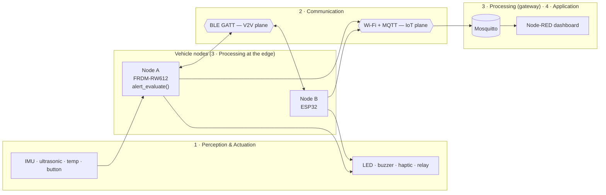

# V2V Motorsport Telemetry

**Telemetry and safety platform for connected competition vehicles (Formula Student, karting, Baja SAE): edge-detected hazards shared vehicle-to-vehicle over BLE, live telemetry over Wi-Fi/MQTT.**

[](https://github.com/TBD_OWNER/v2v-motorsport-telemetry/actions/workflows/ci.yml)
[](LICENSE)

> Status: **scaffold** — structure, contracts, CI and docs are in place; firmware logic starts with M1.

## The problem

In student and amateur motorsport, a driver has no idea that the car ahead just
braked hard behind a crest, that there is an obstacle on the racing line, or that
a car is overheating. Teams also rarely have an affordable way to see live
telemetry and keep a history.

## The solution

Each vehicle is a node that:

1. **measures and publishes** its telemetry (IoT plane: Wi-Fi + MQTT → dashboard), and
2. **detects critical events at the edge** (hard braking, obstacle, over-temperature)
   and **shares them with the other vehicles over BLE** (V2V plane). The receiving
   vehicle drives an actuator: shift light/LED, buzzer, haptic motor or relay.

The V2V path does not depend on Wi-Fi or on the broker.

## Architecture



More diagrams (4-layer view, alert sequence, firmware layers) in
[`docs/02-architecture/architecture.md`](docs/02-architecture/architecture.md).

## Hardware

| Role | Board | Notes |
|---|---|---|
| Main node | NXP **FRDM-RW612** (Arm Cortex-M33, Wi-Fi 6, BLE 5.4, 802.15.4) | MCUXpresso IDE + SDK |
| Secondary node | **ESP32** classic (dev-kit model TBD) | Arduino IDE |
| Gateway | Laptop with Docker | Mosquitto + Node-RED |
| Sensors / actuators | IMU, ultrasonic, temperature; LED, buzzer, haptic, relay | models TBD — [`hardware/bom.md`](hardware/bom.md) |

## Tech stack

C99 · MCUXpresso SDK · Arduino-ESP32 · BLE GATT · MQTT (Eclipse Mosquitto 2) ·
Node-RED · Docker Compose · Python 3 (paho-mqtt, pytest, jsonschema) · Unity ·
GitHub Actions · arduino-cli · Mermaid

## Repository layout

```
interfaces/     protocol contracts — source of truth (MQTT topics, JSON Schema, BLE GATT, C header)
firmware/
  common/       pure C logic, unit-tested on the host
  rw612-node/   FRDM-RW612 firmware: app / services / drivers / board
  esp32-node/   ESP32 Arduino sketch
gateway/        docker-compose: Mosquitto + Node-RED
dashboard/      Node-RED flows
tools/          sync_protocol.py, node-simulator
tests/          unit (Unity) · integration (pytest) · hil (checklist)
hardware/       pinout and BOM
docs/           vision, requirements, architecture, ADRs, test plan, school deliverables
```

## Quickstart

Windows PowerShell shown; the same commands work on Linux/macOS.

**1. Gateway**

```powershell
docker compose -f gateway/docker-compose.yml up -d
# MQTT on localhost:1883, Node-RED on http://localhost:1880
```

**2. Simulator (no hardware needed)**

```powershell
python -m venv .venv; .venv\Scripts\Activate.ps1
pip install -r tools/node-simulator/requirements.txt
python tools/node-simulator/simulator.py --broker localhost:1883 --node-id sim-01 --rate 5
docker exec -it v2v-mosquitto mosquitto_sub -t "v2v/#" -v
```

**3. ESP32 node**

```powershell
python tools/sync_protocol.py
Copy-Item firmware/esp32-node/esp32-node/config.example.h firmware/esp32-node/esp32-node/config.h
arduino-cli compile --fqbn esp32:esp32:esp32 firmware/esp32-node/esp32-node
```

**4. RW612 node** — see [`firmware/rw612-node/README.md`](firmware/rw612-node/README.md)
(project is generated from MCUXpresso IDE; the NXP SDK is not in the repo).

**5. Tests**

```powershell
make -C tests/unit                         # needs host gcc
pip install -r tests/integration/requirements.txt
pytest tests/integration -v
```

## Demo

<!-- TODO(M1): add docs/media/demo.gif — button on node A → buzzer on node B, dashboard updating:
 -->

> 🎬 *Demo GIF coming with M1.*

## Roadmap

| Milestone | Goal | Status |
|---|---|---|
| **M1** | V2V over BLE: button on node A → LED/buzzer on node B | ⏳ next |
| **M2** | Both nodes publish telemetry over MQTT; live dashboard | ⏳ |
| **M3** | Real sensors (IMU, ultrasonic, temperature) and actuators | ⏳ |
| **M4** | Roadmap: Thread/802.15.4 mesh + border router, InfluxDB/Grafana | 🗺️ |

Design decisions are recorded as ADRs in [`docs/adr/`](docs/adr/).

## Team

- Joshua Alejandro Chávez Montero
- Mario Alberto Mireles González
- Kevin Rincones Partida
- Jair Santana Renteria

## License

[MIT](LICENSE)
