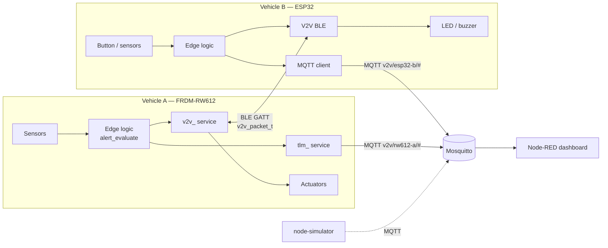
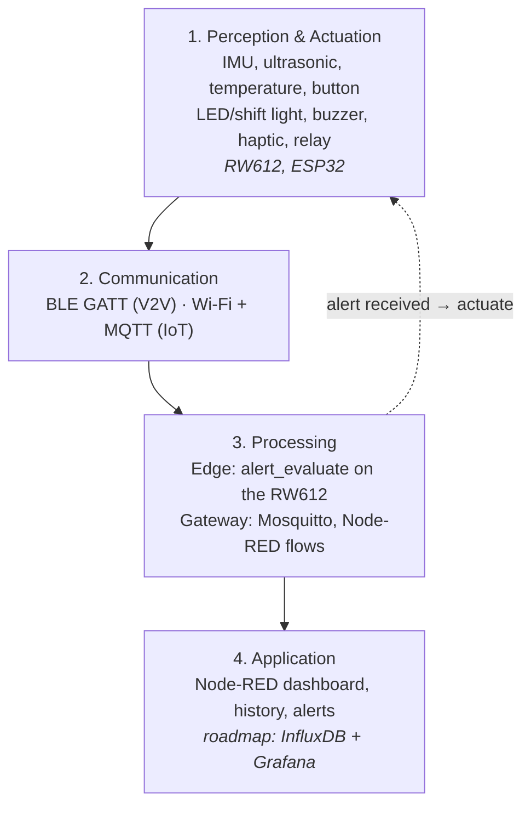
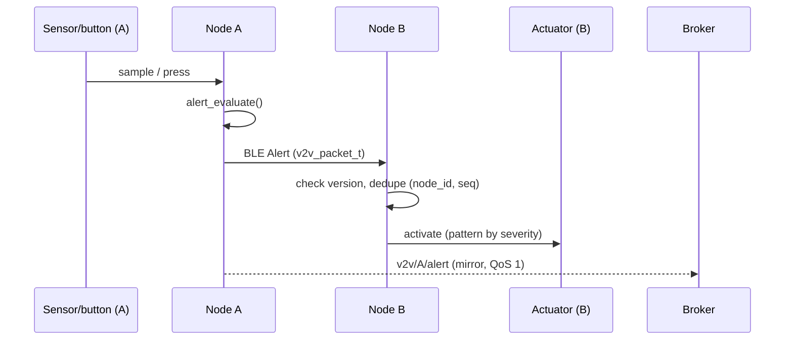
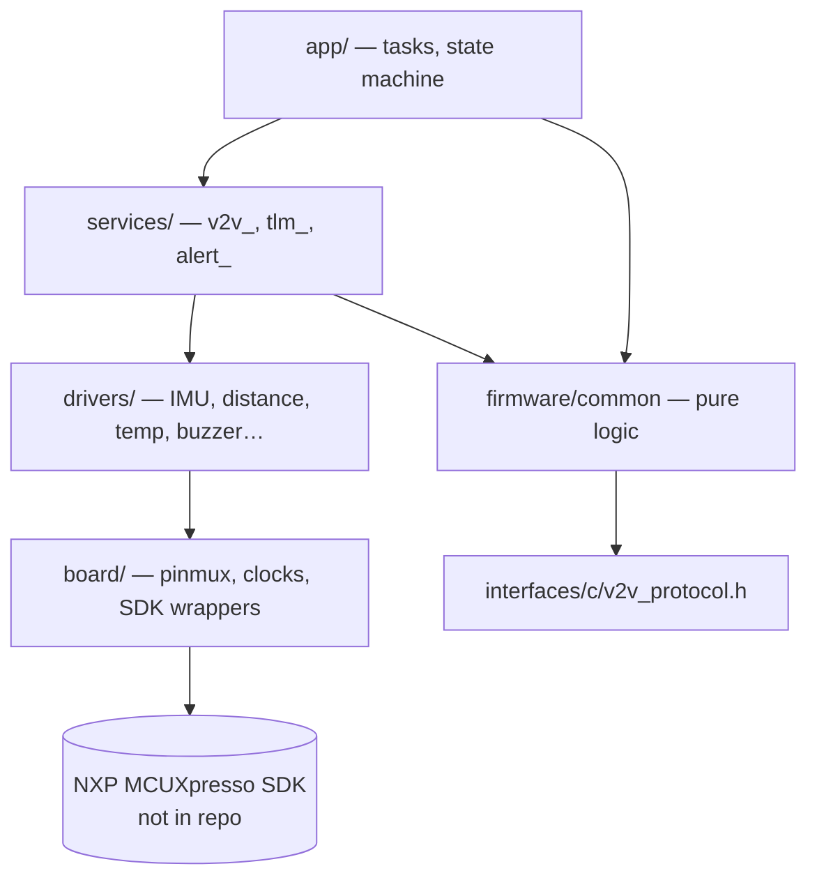

# Architecture

## Two planes

| Plane | Transport | Purpose | Criticality |
|---|---|---|---|
| **V2V** | BLE, custom GATT (`interfaces/ble-gatt.md`) | vehicle ↔ vehicle critical events | safety-relevant, must work alone |
| **IoT** | Wi-Fi + MQTT (`interfaces/mqtt-topics.md`) | telemetry, presence, history | informational |

## Four layers (school deliverable view)

The RW612 belongs to **both** layer 1 (it reads sensors and drives actuators)
and layer 3 (it runs the edge logic that decides whether an event is critical).

## Alert sequence (M1/M3)

## RW612 firmware layers

See [ADR-0005](../adr/0005-layered-firmware-architecture.md).

## Deployment

| Component | Runs on | Build |
|---|---|---|
| rw612-node | FRDM-RW612 | MCUXpresso IDE + SDK (local only) |
| esp32-node | ESP32 dev kit (model TBD) | Arduino IDE / arduino-cli |
| gateway | team laptop, Docker | `docker compose` |
| dashboard | Node-RED container | import `flows.json` |
| node-simulator | any PC, Python 3.10+ | `pip install -r requirements.txt` |
